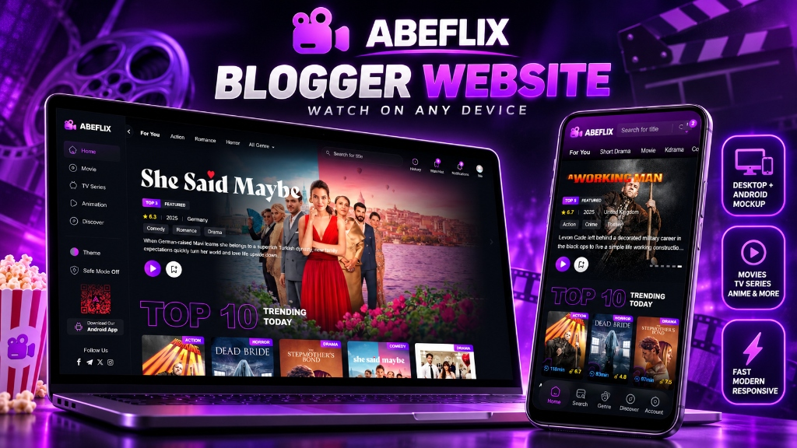

# ABEFLIX ? Next-Generation Blogger Streaming Web App Theme

### Transform your Blogger website into an OTT streaming experience like Netflix.

---

## ? Fast Links & Resources
* ?? **Live Demo:** [abeflixofficial.blogspot.com](https://abeflixofficial.blogspot.com/)
* ?? **Online Documentation & Shortcode Builder:** [ayengcoding.github.io/abeflix](https://ayengcoding.github.io/abeflix/)
* ?? **Purchase Theme (Gumroad):** [Get ABEFLIX on AyengStore](https://ayengstore.gumroad.com/l/abeflix)

---

## ?? Why ABEFLIX?

**ABEFLIX** is a flagship Blogger streaming template engineered with precision for high-traffic anime portals, movie databases, and series streaming sites.

Unlike standard Blogger themes that limit you to basic chronological post feeds, ABEFLIX introduces an advanced **Modular Shortcode Engine** (`{lazyPosts}`), allowing webmasters to configure Netflix-style carousels, responsive video grids, category switcher tabs, and leaderboards right from Blogger layout widgets.

Packed with full web-app features?**User Watchlist**, **Watch History**, **Favorites**, **Custom Avatars**, **Continue Watching Resume Bar**, **Multi-Host Video Player**, and **Dynamic Notifications**?it delivers a true OTT streaming platform feel.

---

## ? Key Features

### ?? 1. Modular Shortcode Engine (`{lazyPosts}`)
Construct and customize homepage sections using lightweight shortcodes in HTML/JavaScript gadgets:
* **Horizontal Carousels:** `{lazyPosts} $label={Action} $results={12} $style={nowrap} $class={carousel-posts}`
* **Ranked Top Lists:** `{lazyPosts} $results={10} $style={top-list} $sortBy={rating}`
* **Filtered Category Switchers:** `{lazyPosts} $label={Romance} $results={6} $style={filtered-switch}`
* **Responsive Movie Grids:** `{lazyPosts} $label={Movie} $results={12} $style={grid}`
* **Wide Card List:** `{lazyPosts} $label={TV Series} $results={9} $style={wide-list} $sortBy={rating}`

### ?? 2. Full User Dashboard & Membership Area
Give visitors their own personalized account dashboard:
* ?? **Watchlist:** Save titles to watch later.
* ?? **Watch History:** Seamlessly track visited movies and series.
* ?? **Favorite List:** Bookmark favorite shows with 1-click.
* ?? **Custom Avatars:** Choose from curated avatar packs (Anime, Heroes, VIP styles).

### ?? 3. "Continue Watching" Playback Resume
Automatically records episode timestamps and playback states in the browser, showing a dedicated rail on the homepage so viewers can jump straight back into the action.

### ?? 4. Built-in In-App Notification Center
Broadcast system updates, new release announcements, and notices directly to the header bell icon with badge counters.

### ?? 5. Fluid Dark Mode, Theme Swatches & Safe Mode
* Integrated theme customizer with 12+ vibrant color swatches.
* Safe Mode switch toggle for censorship/kid-safe browsing.
* Fully responsive across Mobile, Tablet, and Desktop displays.

---

## ?? Quick Setup & Installation

### Step 1: Install the Theme
1. Navigate to your **Blogger Dashboard** > **Theme**.
2. Click the dropdown next to **Customize** and select **Edit HTML**.
3. Replace the entire template code with your licensed **ABEFLIX XML** file and click **Save**.

### Step 2: Required Core Pages
Ensure the following standard pages are published (or imported via `feed.atom`):
* `Favorite` (`/p/favorite.html`)
* `History` (`/p/history.html`)
* `Watchlist` (`/p/watchlist.html`)
* `My Account` (`/p/my-account.html`)
* `Leaderboard` (`/p/leaderboard.html`)
* `Discover` (`/p/discover.html`)
* `About Us` | `Contact Us` | `Disclaimer` | `Privacy Policy`

---

## ?? Complete Documentation
For full widget tutorials, shortcode cheatsheet, player multi-source embed guides, and styling options:
?? **[Open the Official ABEFLIX Documentation Portal](https://ayengcoding.github.io/abeflix/)**

---

## ?? Community & Store
* **Demo Site:** [https://abeflixofficial.blogspot.com/](https://abeflixofficial.blogspot.com/)
* **Official Store:** [AyengStore on Gumroad](https://ayengstore.gumroad.com/l/abeflix)
* **Author / Developer:** Ayeng Coding
